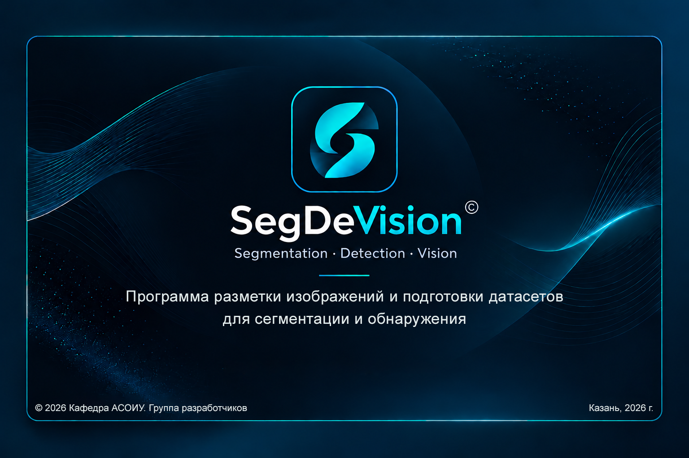
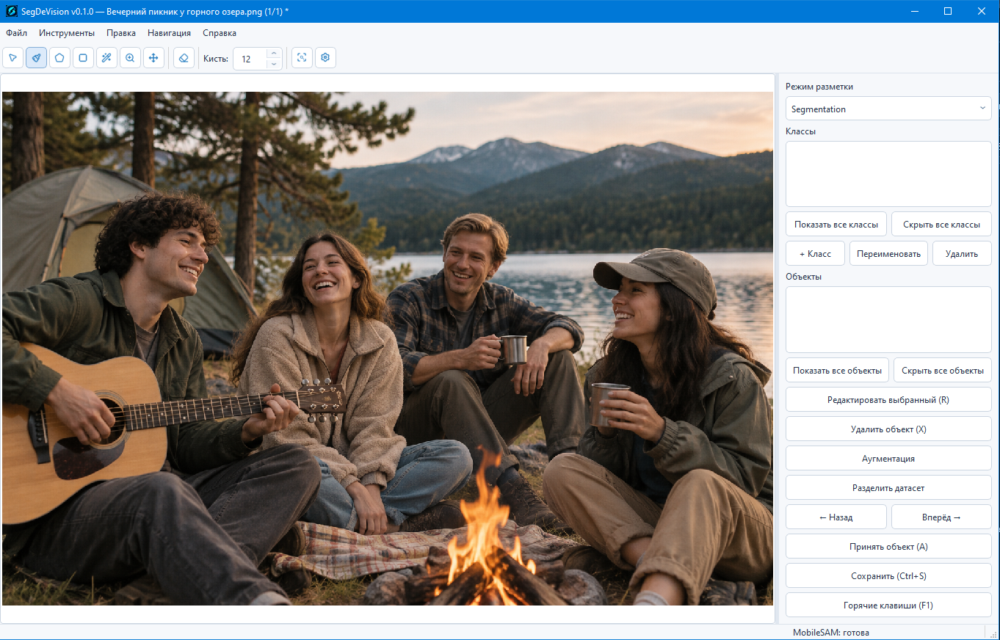
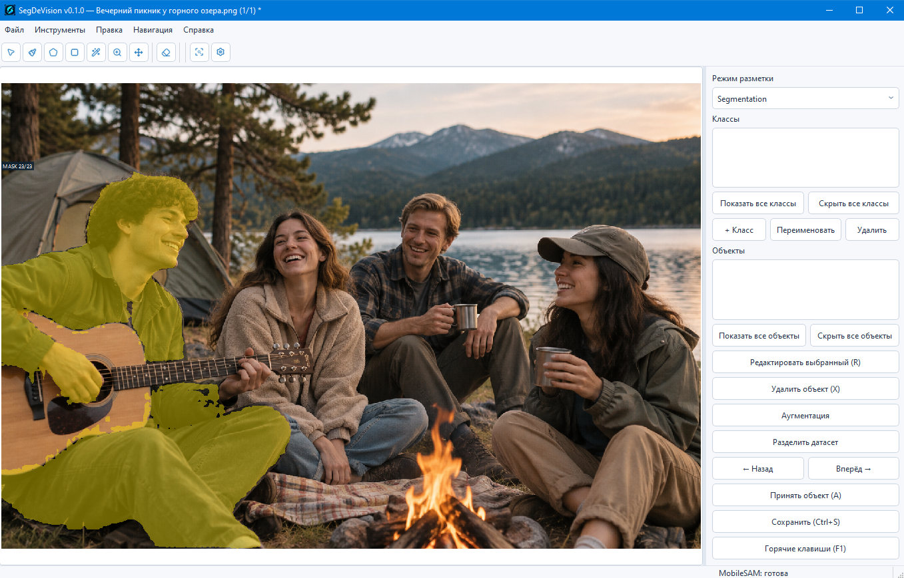
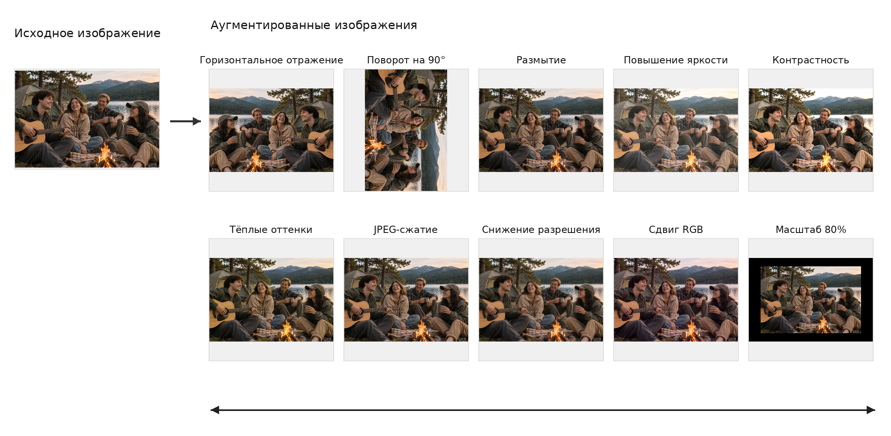
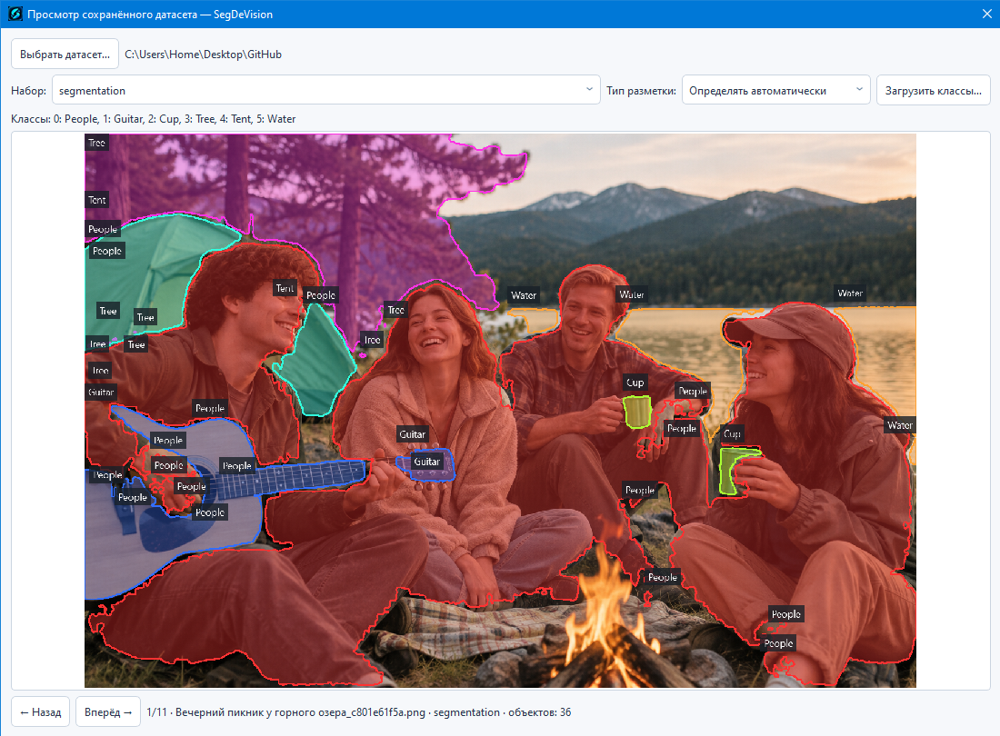

<div align="center">

# SegDeVision

**Segmentation · Detection · Vision**

Приложение для ручной и полуавтоматической разметки изображений и видеокадров и подготовки датасетов **Segmentation** и **Detection** на Windows.

[](https://github.com/dimansid007/SegDeVision/releases)


**[Скачать SegDeVision](https://github.com/dimansid007/SegDeVision/releases/latest)** · **[Сообщить о проблеме](https://github.com/dimansid007/SegDeVision/issues)**

</div>




## О программе

SegDeVision помогает создавать и редактировать аннотации объектов, автоматически предлагать маски с помощью **MobileSAM**, аугментировать изображения и готовить выборки для обучения моделей. Программа предназначена для пользователей готового Windows-приложения: устанавливать Python, PyTorch и CUDA отдельно не требуется.

## Возможности

| Разметка и подготовка | Работа с проектом |
| --- | --- |
| Маски Segmentation: кисть, полигон, Box-заполнение | Создание, переименование и удаление классов |
| Прямоугольники Detection | Импорт существующих аннотаций и `data.yaml` |
| Smart-сегментация и предложения масок MobileSAM (CPU) | Редактирование и удаление объектов |
| Настройка и фильтрация предложений автосегментации | Просмотр сохранённого датасета |
| Аугментации изображений и согласованных аннотаций | Проверка обновлений, обновление и восстановление предыдущей версии |
| Разделение на `train`, `val`, `test` с учётом классов и происхождения видеокадров | Резервное копирование при удалении классов |
| Извлечение кадров из видео, временные диапазоны и предпросмотр | Выбор источника: фотографии, импортированные видео, новые видео |
| Просмотр видеоряда с аннотациями | Переход между источниками после завершения разметки |




## Скачивание и запуск

1. Откройте **[GitHub Releases](https://github.com/dimansid007/SegDeVision/releases/latest)**.
2. Скачайте `SegDeVision_vX.Y.Z_Windows_x64.zip` и распакуйте его в отдельную папку. В архиве находятся `SegDeVision.exe` и `SegDeVisionUpdater.exe` — **сохраняйте их вместе**. Можно также скачать эти EXE по отдельности.
3. Запустите `SegDeVision.exe`.
4. Укажите папку исходных изображений, необязательный входной датасет и папку выходного датасета. Нажмите **«Начать разметку»**.
5. Выберите источник разметки: обычные изображения, уже импортированное видео или видео для импорта. Затем выберите **Segmentation** или **Detection**, создайте классы и приступайте к разметке.

**Системные требования:** Windows x64; для MobileSAM используется процессор (CPU), видеокарта с CUDA не обязательна. На некоторых компьютерах необходим актуальный **Microsoft Visual C++ Redistributable x64**.

## Быстрый рабочий процесс

1. Выберите изображение и нужный режим.
2. Добавьте классы, если они ещё не загружены из старого датасета.
3. Разметьте объект вручную или с помощью MobileSAM; проверьте контур и **подтвердите объект**.
4. При необходимости включите аугментации и сохраните разметку.
5. Выполните **«Разделить датасет»**, задайте доли `train / val / test` (первоначально предлагается `70 / 20 / 10`).
6. Для обучения используйте `data.yaml` нужного режима из папки `training_split`.

Аугментированные варианты попадают **только в `train`** вместе со своим исходным изображением. В `val` и `test` используются оригиналы, что снижает риск утечки похожих данных между выборками. После изменений в разметке или классах повторно выполняйте разделение датасета.

## Работа с видео (v0.1.1)

1. Поместите видеофайлы в папку исходных данных либо откройте **«Файл → Видео → Импортировать видео…»**.
2. В окне **«Параметры извлечения кадров»** проверьте сведения об исходном видео: число кадров, FPS и длительность. Выберите **каждый N-й кадр** (`1` — каждый кадр), при необходимости укажите временные диапазоны в секундах, по одному на строку (например, `0-10` и `15-25`). Пустое поле означает всё видео.
3. При необходимости задайте **группу происхождения**. Одно и то же имя (например, `traffic_A`) для связанных видео означает, что при разделении **целыми группами** их кадры не будут распределяться между разными выборками. Группа указывается при импорте каждого видео; это не отдельная папка в окне выбора источника.
4. Проверьте выбранные кадры в предпросмотре и подтвердите импорт. Извлечённые кадры доступны для разметки так же, как изображения.
5. Через **«Файл → Выбрать источник разметки…»** переключайтесь между обычными изображениями, импортированными видеорядами и видео для импорта. При достижении последнего кадра программа может предложить выбрать другой источник. **«Файл → Видео → Предпросмотр видеоряда…»** позволяет просматривать извлечённые кадры и аннотации.

### Разделение видеокадров на train / val / test

В окне **«Разделение датасета»** доступно четыре варианта:

- **Автоматически:** если найдено три и более групп происхождения, распределяются целые группы; иначе используется последовательное разделение.
- **Целыми видеозаписями / группами:** все кадры одной группы попадают в одну выборку.
- **Последовательно по времени:** извлечённые кадры каждого видеоряда распределяются по порядку кадров.
- **Как обычные изображения (случайно):** видеокадры участвуют в обычном разделении без защиты от близких кадров.

Перед экспортом программа показывает предварительное распределение и количество аугментаций в `train`. Если при выбранной стратегии какая-либо выборка с ненулевой долей пуста, измените стратегию или добавьте данные. **Защитные временные промежутки не используются.** Близкие кадры из одного видео могут завышать качество на `val/test` при последовательном или случайном разделении. Аугментированные варианты по-прежнему направляются только в `train`.

**Скриншоты для документации:** `docs/images/SourceSelection.png`, `docs/images/VideoExtraction.png`, `docs/images/VideoPreview.png`, `docs/images/VideoSplit.png`. Добавьте настоящие снимки этих окон в указанные файлы перед публикацией; имена приведены как рекомендуемые.

## Структура выходного датасета

```text
dataset_export/
├── segmentation/
│   ├── images/
│   ├── labels/
│   └── data.yaml
├── detection/
│   ├── images/
│   ├── labels/
│   └── data.yaml
├── training_split/
│   ├── segmentation/
│   │   ├── images/{train,val,test}/
│   │   ├── labels/{train,val,test}/
│   │   └── data.yaml
│   └── detection/
│       ├── images/{train,val,test}/
│       ├── labels/{train,val,test}/
│       └── data.yaml
├── classes.json
├── class_mapping.json
├── augmentation_manifest.json
└── split_manifest.json
```

**Важно:** извлечённые видеокадры и `video_frames.json` находятся в папке **исходных данных** (`_segdevision_video_frames/<видео>/`), а не в `dataset_export/`. В выходном датасете сохраняются экспортированные изображения/аннотации, а сведения о видеопроисхождении при разделении записываются в `split_manifest.json`. Не изменяйте служебные JSON-файлы вручную без резервной копии.



## Если MobileSAM не запускается

Если при загрузке MobileSAM возникает **`WinError 126`** с упоминанием `torch\lib\shm.dll`:

1. Установите [**Microsoft Visual C++ Redistributable x64** с сайта Microsoft](https://aka.ms/vs/17/release/vc_redist.x64.exe). Установщик также может быть приложен к выпуску в разделе Assets.
2. Перезагрузите Windows и снова запустите SegDeVision.
3. Если ошибка повторяется, создайте [Issue](https://github.com/dimansid007/SegDeVision/issues) и укажите версию Windows, версию SegDeVision и полный текст ошибки.

На тестовом устройстве установка актуального пакета Visual C++ устранила эту ошибку. **Python, PyTorch и CUDA устанавливать отдельно не нужно.**

## Обновления

Приложение проверяет новые версии через GitHub Releases. Для автоматического обновления необходим `SegDeVisionUpdater.exe` рядом с основной программой. Перед обновлением сохраните разметку; при неудачном обновлении предусмотрен механизм восстановления предыдущей версии.

## Руководство пользователя

Подробные инструкции по инструментам, классам, аугментациям, экспорту и просмотру датасетов находятся в руководстве пользователя.

[Руководство пользователя](Руководство_пользователя_SegDeVision.pdf)

## Обратная связь

Ошибки и предложения можно отправлять через **[GitHub Issues](https://github.com/dimansid007/SegDeVision/issues)**. При сообщении об ошибке приложите шаги воспроизведения и скриншот (без конфиденциальных данных).

---

<div align="center"><sub>SegDeVision · Разработчик: Дмитрий Сидоренко · 2026</sub></div>
